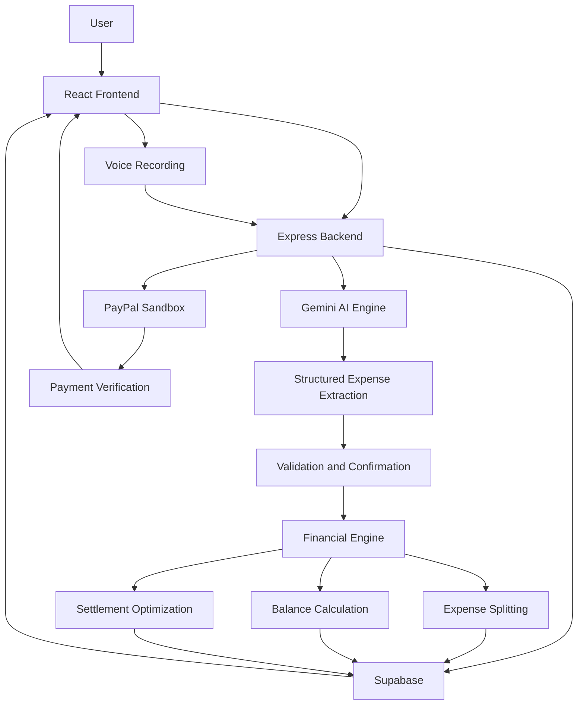

# Settlr AI
### Your trip. Your expenses. One intelligent settlement.

**Settlr AI** is an AI-powered group expense management and settlement platform that makes managing shared trip expenses effortless. Instead of manually entering every transaction, calculating individual shares, and arguing over who owes whom, simply tell Settlr what happened.

Using conversational AI and voice intelligence, Settlr transforms natural language into structured expenses, calculates accurate balances, and recommends optimized settlements.

**Stop calculating. Start exploring. Let Settlr handle the math.**

---

## ✨ Why Settlr AI?

Group trips are memorable. Splitting expenses usually isn't.

One person pays for dinner, another books the hotel, someone else covers fuel, and suddenly nobody knows who owes whom.

Traditional expense trackers require users to manually enter transactions, select participants, configure splits, and calculate balances.

Settlr AI introduces a smarter approach.

Simply say:

> "I paid ₹2,400 for dinner. Split it equally between me, Alex and Chris."

Settlr understands the instruction, extracts the expense details, calculates everyone's share, and updates the trip's financial records after confirmation.

No complicated spreadsheets. No endless calculations. Just conversational expense management.

---

## 🚀 Key Features

### 🧠 AI-Powered Expense Management
- Natural-language expense creation.
- Intelligent extraction of amounts, categories, payers and participants.
- Context-aware conversational assistant.
- Multi-expense processing.
- Expense editing and deletion through supported AI actions.
- Clarification when information is incomplete or ambiguous.

### 🎙️ Voice-First Expense Recording
- Microphone-based expense recording.
- Continuous recording sessions.
- Natural speech input.
- Multiple expenses from a single recording.
- AI-powered transcription and expense extraction.
- Expense review before confirmation.

### 💰 Flexible Expense Splitting
- Equal splitting.
- Percentage-based splitting.
- Custom amount allocation.
- Multiple contributors.
- Participant exclusions.
- Accurate remainder distribution.

### 📊 Intelligent Financial Tracking
- Individual spending summaries.
- Trip-wide expense analytics.
- Member-wise balances.
- Category-wise spending insights.
- Outstanding balance tracking.
- Optimized settlement recommendations.

### 🔄 Smart Settlement Engine
- Calculates who owes whom.
- Reduces unnecessary transactions.
- Supports settlement tracking.
- Maintains financial consistency.
- Distinguishes manually recorded settlements from verified digital payments.

### 💳 PayPal Integration
- PayPal Sandbox integration.
- Server-side order creation.
- Payment approval and capture.
- Payment status tracking.
- Webhook-based payment event verification.

### 🔐 Secure Trip Management
- User authentication.
- Trip creation and member management.
- Supabase-backed data storage.
- Row Level Security.
- Authenticated backend APIs.
- Confirmation before financial mutations.

---

## 🛠️ Technology Stack

| Layer | Technologies |
|---|---|
| Frontend | React, Vite, TypeScript |
| Styling | Tailwind CSS, Framer Motion |
| UI Icons | Lucide React |
| Data Visualization | Recharts |
| Backend | Node.js, Express, TypeScript |
| AI Engine | Google Gemini API |
| AI SDK | `@google/genai` |
| Database | Supabase PostgreSQL |
| Authentication | Supabase Auth |
| Payments | PayPal Developer Sandbox |
| Validation | Zod |
| Testing | Vitest / Playwright (where configured) |
| Deployment | Vercel / Render |

---

## 🏗️ System Architecture

Settlr follows a modular architecture that separates AI interpretation from financial execution.



### The Intelligence Behind Settlr

Settlr uses a hybrid AI and deterministic computing architecture.

**Gemini AI handles:**
- Understanding natural language.
- Extracting expense information.
- Interpreting conversational context.
- Resolving user instructions.
- Identifying missing information.

**The deterministic backend handles:**
- Financial calculations.
- Expense validation.
- Participant authorization.
- Balance aggregation.
- Settlement optimization.
- Payment verification.

This separation ensures that AI-generated interpretations never become authoritative financial calculations.

---

## 🧮 How Expense Splitting Works

Consider a group dinner costing ₹2,400.

The expense is paid entirely by one person and shared equally between three participants.

| Participant | Share |
|---|---:|
| You | ₹800 |
| Alex | ₹800 |
| Chris | ₹800 |
| **Total** | **₹2,400** |

If you paid the entire amount:

- Alex owes you ₹800.
- Chris owes you ₹800.
- Your own share is ₹800.

Settlr calculates these values using integer minor units to avoid floating-point money errors.

All expense shares must reconcile exactly with the original expense amount.

---

## 📂 Project Structure

```text
settlr-ai/
│
├── client/
│   └── src/
│       ├── components/
│       ├── pages/
│       ├── layouts/
│       ├── hooks/
│       ├── context/
│       ├── services/
│       ├── types/
│       └── utils/
│
├── server/
│   └── src/
│       ├── config/
│       ├── controllers/
│       ├── routes/
│       ├── middleware/
│       ├── services/
│       │   ├── gemini/
│       │   ├── voice/
│       │   ├── expenses/
│       │   ├── splitting/
│       │   ├── settlement/
│       │   ├── paypal/
│       │   └── notifications/
│       ├── repositories/
│       ├── schemas/
│       ├── types/
│       └── utils/
│
├── docs/
├── BUILD_STATUS.md
├── README.md
└── .gitignore
```

*The actual directory structure may differ depending on implementation.*

---

## ⚙️ Getting Started

### Prerequisites

Make sure you have:

- Node.js (LTS recommended).
- npm.
- A Supabase project.
- A Google Gemini API key.
- PayPal Developer Sandbox credentials for payment testing.

### 1. Clone the repository

```bash
git clone YOUR_REPOSITORY_URL
cd settlr-ai
```

### 2. Install dependencies

```bash
cd client
npm install

cd ../server
npm install
```

### 3. Configure environment variables

Create the required environment files using the supplied example environment files.

**Frontend configuration (`client/.env`):**

```env
VITE_SUPABASE_URL=
VITE_SUPABASE_ANON_KEY=
VITE_API_URL=
```

**Backend configuration (`server/.env`):**

```env
PORT=5000
NODE_ENV=development

SUPABASE_URL=
SUPABASE_ANON_KEY=
SUPABASE_SERVICE_ROLE_KEY=

GEMINI_API_KEY=
GEMINI_MODEL=

PAYPAL_ENVIRONMENT=sandbox
PAYPAL_CLIENT_ID=
PAYPAL_CLIENT_SECRET=
PAYPAL_WEBHOOK_ID=
PAYPAL_CURRENCY=USD
```

Use the actual variable names expected by your implementation. Do not expose private credentials.

### 4. Start the backend

```bash
cd server
npm run dev
```

### 5. Start the frontend

Open another terminal:

```bash
cd client
npm run dev
```

Open the local URL displayed by Vite.

---

## 🧪 Testing

Settlr should be tested across its complete expense-management workflow.

Important test scenarios include:

- User registration and authentication.
- Trip creation and member management.
- Natural-language expense extraction.
- Continuous voice recording.
- Multiple expenses in one recording.
- Equal, percentage and custom splits.
- Multiple contributors.
- Excluded participants.
- Balance reconciliation.
- Settlement optimization.
- Confirmation and cancellation.
- PayPal Sandbox order creation and capture.
- Payment failure and recovery.
- Database authorization and RLS.

### Financial Integrity Rules

- Total participant shares must equal the expense total.
- Total payer contributions must equal the expense total.
- Aggregate balances must equal zero for each currency.
- Excluded participants must never be charged.
- Duplicate requests must not create duplicate transactions.
- Failed payments must never be marked completed.

---

## 🔒 Security

Settlr is designed around secure financial operations.

- Server-side Gemini API integration.
- Server-side PayPal credentials.
- Supabase Row Level Security.
- Authenticated API requests.
- Backend validation of financial operations.
- Explicit confirmation for expense mutations.
- Idempotent payment processing.
- Verified PayPal webhook events.
- No client-side authority over financial balances.

Never commit `.env` files, API keys, access tokens or payment secrets.

---

## 🗺️ Roadmap

- [x] Project foundation.
- [x] Database and authentication implementation.
- [x] Gemini AI agent implementation.
- [x] Voice intelligence implementation.
- [x] Financial calculation engine.
- [x] PayPal Sandbox integration implementation.
- [x] Frontend implementation.
- [x] End-to-end integration and deployment preparation.
- [ ] Complete real-world testing.
- [ ] Final production deployment.
- [ ] Production payment integration and verification.

*Development milestones do not imply that every feature has passed live testing. Refer to BUILD_STATUS.md and FINAL_TEST_REPORT.md for verified implementation status.*

---

## 🌍 Vision

We believe managing shared expenses should feel effortless.

Settlr aims to move beyond traditional expense trackers by combining conversational AI, voice interaction, deterministic financial computation and digital payments into one intelligent experience.

Whether it's a weekend getaway, a long vacation, a group dinner or everyday shared expenses, Settlr makes settling up simpler.

**Spend together. Settle smarter.**

---

## 🏆 Hackathon Project

Built as a project for the **PayPal AI Hackathon**.

**Project:** Settlr AI  
**Category:** AI-powered expense management and payments  
**Core Innovation:** Conversational and voice-driven multi-expense extraction with deterministic financial settlement.

---

## 📄 License

Choose and add an appropriate open-source license before publicly distributing this repository. Until then, all rights are reserved by the project owners.
